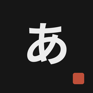
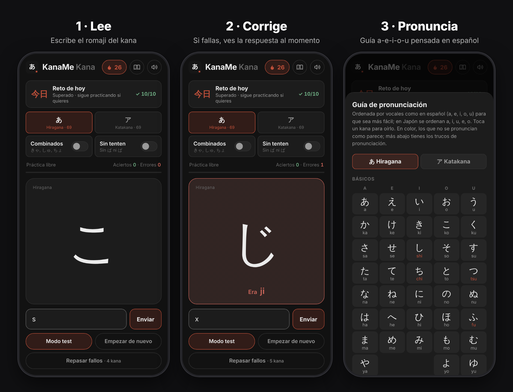
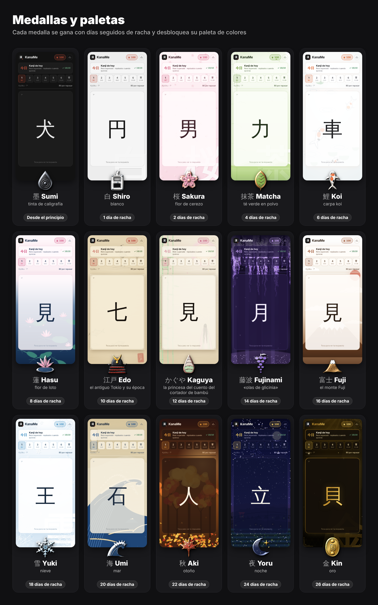
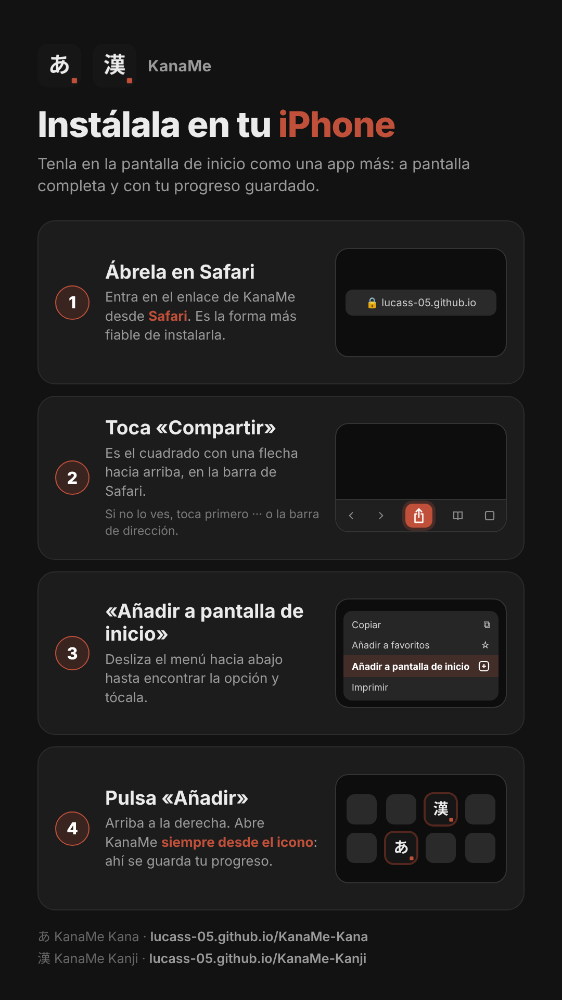
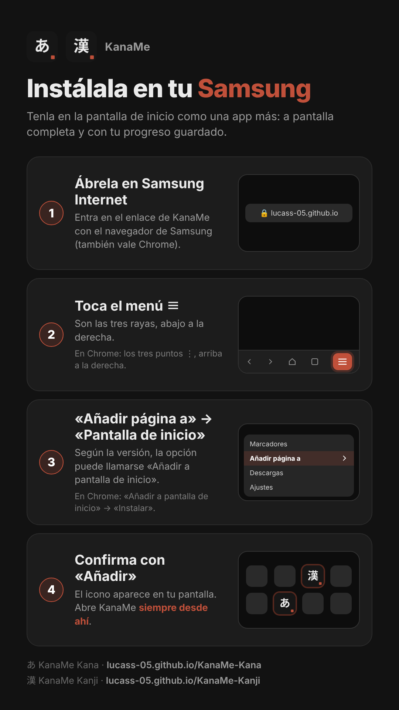

<div align="center">



# KanaMe Kana

### Lee hiragana y katakana con soltura en pocos días.

Práctica rápida para el móvil: ves un kana, escribes su romaji y sabes al instante si has acertado.<br>
Sin cuentas · Sin anuncios · Funciona sin conexión

**[▶ Abrir KanaMe Kana](https://lucass-05.github.io/KanaMe-Kana/)**


</div>

<br>

<p align="center"></p>

## Cómo funciona

1. **Lee.** Aparece un kana. Escribe su romaji y pulsa *Enviar* (o Intro).
2. **Corrige.** Si aciertas, pasa al siguiente. Si fallas, ves la respuesta correcta antes de continuar.
3. **Examínate.** El **modo test** te pregunta todos los kana elegidos una sola vez, en orden aleatorio, y al final te da una nota sobre 10 con la lista de fallos. Con un toque repasas solo esos.

4. **Repasa tus fallos.** La app recuerda los kana que fallas. *Repasar fallos* te los pregunta empezando por el que más fallas; cada acierto le resta un fallo y los que vuelves a fallar se repiten enseguida.

## Elige qué practicar

| Opción | Qué incluye |
|---|---|
| **あ Hiragana** | Los 69 hiragana básicos, con tenten (が, ば, ぱ…) |
| **ア Katakana** | Los mismos 69 en katakana |
| **Combinados** | Sílabas como きゃ, しゅ, チョ (33 por alfabeto) |
| **Sin tenten** | Quita las formas con ゛ y ゜: solo は, nunca ば ni ぱ |

Puedes combinarlas como quieras, y la app recuerda tu elección.

Se aceptan tanto la romanización Hepburn como las variantes más habituales: *shi* o *si*, *tsu* o *tu*, *fu* o *hu*, *wo* u *o*…

## Racha, medallas y guía

- **Reto de hoy.** Elige tu reto: acertar 5, 10 o 20 kana al día (en práctica libre o en el test) para sumar un día a tu **racha 🔥**.
- **Medallas y paletas.** El primer día ganas la medalla 白 Shiro, el segundo 桜 Sakura y después una cada 2 días hasta 金 Kin (26 días). Cada medalla trae su paleta de colores, con fondo y efectos propios; las de 江戸 Edo y かぐや Kaguya cambian además la letra a pincel.
- **Guía de pronunciación.** La tabla de todos los kana con su romaji, por separado para hiragana y katakana, con trucos de pronunciación para hispanohablantes. Toca un kana para oírlo.
- **Recordatorio diario.** Un aviso a la hora que elijas si aún no has superado el reto del día.

## Por qué funciona

- **Recuerdo activo.** Escribir la lectura de memoria fija el kana mucho mejor que mirar una tabla.
- **Corrección inmediata.** Ver la respuesta justo después de fallar evita que un error se convierta en costumbre.
- **Ritmo rápido.** Cada pregunta dura un par de segundos. En cinco minutos repasas decenas de kana.
- **Ir por partes.** Empieza por los kana sin tenten, añade después ゛ y ゜, luego los combinados y por último el katakana.

> Con 10 minutos al día se suele leer todo el hiragana en una semana, y el katakana en otra.

## Medallas y paletas

<p align="center"></p>

## Instalar en el móvil

Añádela a la pantalla de inicio y se abrirá a pantalla completa, como una app nativa.

| iPhone (Safari) | Samsung / Android |
|:---:|:---:|
|  |  |
| **Compartir → Añadir a pantalla de inicio** | **Menú ≡ → Añadir página a → Pantalla de inicio**<br><sub>En Chrome: ⋮ → Añadir a pantalla de inicio</sub> |

## Privacidad

Sin cuentas ni registro: tus ajustes se guardan solo en tu dispositivo. Para saber cuánta gente usa la app se cuentan las visitas de forma anónima con [GoatCounter](https://www.goatcounter.com): sin cookies, sin datos personales y sin seguimiento entre webs.

## Familia KanaMe

- **KanaMe Kana**: hiragana y katakana (esta app).
- **[KanaMe Kanji](https://github.com/lucass-05/KanaMe-Kanji)**: los 2136 kanji Jōyō con repetición espaciada, 5, 10 o 20 kanji nuevos cada día (tú eliges) y rachas con premios. Es el siguiente paso cuando ya lees kana.

## Para desarrolladores

HTML, CSS y JavaScript puros, sin dependencias ni compilación.

```bash
python3 -m http.server 8000   # y abre http://localhost:8000
```

| Archivo | Contenido |
|---|---|
| `index.html` | Interfaz, datos y lógica. El katakana se genera a partir del hiragana |
| `sw.js` | Service worker (modo sin conexión). Sube `VERSION` al publicar cambios |
| `audio/` | Sonidos de acierto y fallo (se pueden silenciar desde la app) |
| `icons/` | Iconos para iOS, Android y navegador |

## Licencia

© 2026 Lucas Suárez. Código publicado bajo la licencia **[GNU AGPL-3.0](LICENSE)**.

Puedes usar y estudiar KanaMe Kana libremente. Si copias o modificas el código y lo distribuyes o lo publicas como web o app, debes mantener el aviso de autoría y publicar tu código completo bajo la misma licencia.

<div align="center"><sub>Hecho con 墨 y paciencia · がんばって！</sub></div>
